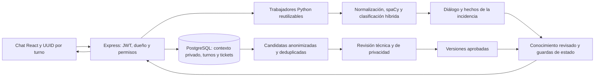

# Mejora del asistente FTTH — entrega y validación

Fecha: 13 de octubre de 2026, hora de Bolivia.

Los cambios están implementados en este proyecto local. Se conservaron los cambios que ya existían al iniciar el trabajo; no se restableció el repositorio ni se creó un commit que mezclara ambos trabajos. No se desplegó al servidor público.

## Resultado comprobado

| Verificación | Resultado |
|---|---|
| Python, con modelo español instalado | 95 pruebas aprobadas |
| Node, incluidas PostgreSQL, seguridad y concurrencia | 82 pruebas aprobadas; ninguna omitida |
| 30 escenarios del prompt | Pruebas ejecutables en `Backend/chat/test_acceptance_ftth.py` |
| React/Vite | Compilación de producción correcta |
| ESLint | Sin errores |
| Chrome de prueba, escritorio y móvil | Revisión de conocimiento, cambio de categoría administrativa, reintento con el mismo UUID, Enter rápido, mensajes únicos y ausencia de errores JavaScript |
| PostgreSQL | Esquema real inspeccionado; migración 012 ejecutada dos veces sin errores |
| SMTP | Conexión y autenticación aceptadas; no se enviaron correos |
| Caída de Python | Petición interrumpida controlada; trabajador recuperado para la siguiente petición |

Los resultados reproducibles están en `ASISTENTE-validacion-real.json`. El ejemplo ejecutado y sus tiempos están en `ASISTENTE-conversacion-real.json`; sus mensajes son sintéticos y no crearon tickets en PostgreSQL. Las capturas de interfaz están en `../tmp/assistant-ui/` y usan una API simulada, no cuentas reales.

## Auditoría y causas

La línea de base tenía 58 pruebas Python y 61 Node aprobadas, pero no cubría varias exigencias nuevas. Tres pruebas PostgreSQL estaban desactivadas por defecto; después se habilitaron y ejecutaron.

| Archivo o módulo | Tipo de hallazgo | Causa | Corrección | Riesgo | Verificación |
|---|---|---|---|---|---|
| `chat/nlp.py` | Error comprobado | La similitud ignoraba los vectores del modelo | Similitud vectorial real y alternativa léxica; caché acotada | Medio | Vectores, alternativa sin modelo y conversaciones |
| Entorno Python | Error comprobado | Se estaba utilizando `es_blank`; no había modelo español con vectores | Instalado `es_core_news_md` 3.8.0 en `.venv312` | Medio | Suite completa con el modelo instalado |
| `knowledge_base.py` | Error comprobado | Variantes informales, negaciones y facturación perdían su intención | Normalización, límites de palabras, precedencia por síntomas y contexto | Medio | Abreviaciones, errores y síntomas negados |
| `scope_reply` | Error comprobado | El filtro del portal bloqueaba síntomas del sistema de ventas; una aclaración temprana impedía usar el clasificador | Enviar síntomas reconocidos al motor y permitir clasificación semántica | Medio | Ventas, consulta nueva y fuera de dominio |
| `guided_answers.py` | Error comprobado | Una luz roja genérica se guardaba como LOS; “no” se guardaba como LOS apagada | Separar color observado de indicador identificado | Medio | Luz roja sin etiqueta y negaciones |
| `dialog_manager.py` | Error comprobado | Preguntas rígidas y hechos anteriores conservados al cambiar de incidencia | Ramas por dispositivo, distancia y aplicación; contexto anterior acotado y hechos nuevos separados | Medio | Continuidad, cambio de problema, pasos ya contestados |
| `guided_flows.py` | Error comprobado | Consultar YouTube iniciaba preguntas sobre videollamadas | Preguntar por otras aplicaciones y comparar dispositivos | Bajo | YouTube, Netflix, clases y aplicación aislada |
| `customer_language.py` | Mejora implementada | Respuestas con jerga innecesaria | Presentación sencilla, separada del diagnóstico técnico; definiciones cuando se solicitan | Bajo | Respuestas y ausencia de jerga en escenarios |
| Prioridad Python/Node | Error comprobado | Categoría empresarial daba ALTA automáticamente; ubicación rural bajaba la prioridad | Reglas compartidas y configurables por daño, interrupción, duración e impacto reportado | Medio | Casos comparativos y manipulación desde chat |
| `ConversationController.js` | Error comprobado | Varias preguntas de visita no consultaban el ticket real | Consulta autorizada de estado y fecha; hora de Bolivia | Medio | Tickets propios y fechas existentes |
| `Ticket.js` | Error comprobado | Duplicados protegidos solo durante cinco minutos | Reutilizar reclamos abiertos de la misma falla y mantener idempotencia por turno | Medio | Exclusión mutua, reintento y notificación única |
| `AssistantKnowledgeService.js` | Error comprobado | Deduplicación solo por mensaje de origen | Huella de contenido anonimizado, contador y marca de procesamiento transaccional | Medio | Dos respuestas equivalentes generan una candidata |
| `AssistantKnowledgeService.js` | Mejora implementada | Consulta de conocimiento repetida en cada mensaje | Caché de 30 segundos e invalidación al revisar conocimiento | Bajo | Publicación, revisión y recuperación |
| `User.js` | Error comprobado | Perfil propio podía cambiar categoría; campos omitidos se convertían en valores vacíos | Categoría solo por opción administrativa y preservación de campos omitidos | Medio | SQL real dentro de transacción revertida y pruebas de autorización |
| `ClienteDashboard.jsx` | Riesgo confirmado en código | Estado de React no bloqueaba dos eventos síncronos; ID local cambiaba al reenviar | Bloqueo inmediato con referencia y mensaje local ligado al UUID | Bajo | Dos Enter rápidos y reintento tras 503 |
| `Notifications.jsx` | Error comprobado | Aceptación SMTP se presentaba como entrega | Etiquetas que describen aceptación por el servidor de correo | Bajo | Compilación y revisión de la semántica de estados |
| Base PostgreSQL | Riesgo histórico descartado localmente | El error 42P01 podía deberse a falta de migración o distinta conexión | Inspección real: las cuatro tablas de aprendizaje ya existían en `public` | Bajo | Consulta del catálogo; no se crearon tablas duplicadas |

La base local es `ftth_entel_db`, esquema `public`, con búsqueda `"$user", public`. La inspección inicial de categorías encontró HOGAR. El perfil admite HOGAR, NEGOCIO e INSTITUCION; los colegios pertenecen a esta última. No se deduce la categoría por el formato de la instancia.

## Arquitectura final



La API obtiene la identidad del JWT y consulta exclusivamente el perfil, las conversaciones y los tickets autorizados. Python restaura el contexto en cada turno; no usa como memoria del cliente los datos de la petición anterior. El puente también descarta contextos de otro dueño. Los trabajadores conservan el modelo, pero cada uno atiende un turno a la vez.

La comprensión combina patrones de síntomas, normalización, similitud léxica y vectores del modelo español. El margen entre intenciones evita elegir una categoría cuando los resultados son demasiado parecidos. Los puntajes de confianza son heurísticos; no equivalen a una probabilidad calibrada de diagnóstico correcto.

La recuperación combina conceptos FTTH, similitud y vectores, pero exige una intención, un procedimiento y unas condiciones compatibles. El conocimiento de preguntas nuevas solo puede reemplazar una orientación en estado START; no reemplaza pasos de diagnóstico, consentimiento o registro de reclamos. Se conserva compatibilidad con los procedimientos aprobados bajo la política anterior. Ninguna candidata, voto de cliente o texto generado se aprueba automáticamente.

Las razones de prioridad se guardan en el ticket. La categoría procede del perfil administrativo; los síntomas, la duración y el impacto siguen siendo declaraciones del cliente pendientes de verificación técnica. El tono emocional y la ubicación rural no alteran por sí solos la urgencia. Esta actualización no reordena ni modifica tickets ya en atención.

## Archivos de esta intervención

Motor: `Backend/chat/nlp.py`, `intent_classifier.py`, `knowledge_base.py`, `guided_flows.py`, `guided_answers.py`, `dialog_manager.py`, `assistant_runner.py`, `knowledge_retrieval.py`, `knowledge_policy.json`, `priority_policy.py`. Nuevos: `customer_language.py`, `priority_rules.json`, `test_acceptance_ftth.py`.

Backend: `src/services/AssistantBridge.js`, `PythonRuntime.js`, `AssistantKnowledgeService.js`, `TicketPriorityService.js`, `FailureCatalog.js`; nuevo `AssistantWorkerPool.js`; `src/controllers/ConversationController.js`, `UserController.js`; `src/models/Ticket.js`, `User.js`; `package.json`.

Base: nueva `Backend/sql/012_assistant_candidate_dedup.sql`. Añade huella, contador y fecha de última observación a las candidatas, y tres índices. No borra ni reescribe los candidatos anteriores. No hace falta volver a crear la migración 011 en la base local.

Interfaz: `Frontend/src/pages/cliente/ClienteDashboard.jsx`, `pages/Notifications.jsx`, `pages/admin/GestionUsuarios.jsx`. El administrador dispone de un selector de categoría en la edición del cliente; se mantuvo el diseño de los paneles.

Pruebas y herramientas: `Backend/chat/test_natural_conversation.py`, `test_learning_conversation.py`; `Backend/tests/assistant-integration.test.cjs`, `assistant-learning.test.cjs`, `customer-portal.test.cjs`; nuevos `assistant-priority.test.cjs`, `assistant-workers.test.cjs`; `Frontend/tests/assistant-learning-browser.cjs`; nuevos `Backend/scripts/validate-assistant.cjs`, `benchmark-assistant.cjs`, `migrate-assistant.cjs`.

Los demás cambios que aparezcan en Git pueden ser anteriores a esta intervención. Los reportes anteriores de `deploy/` se conservaron.

## Instalación y ejecución

Entorno probado: Python 3.12.14, spaCy 3.8.15, modelo nuevo `es_core_news_md` 3.8.0, Node 24.12.0, Express 5.2.1 y pg 8.21.0. No se añadió un servicio de pago ni una dependencia nueva de Node. El modelo es local; no se envían conversaciones a un proveedor de IA.

Para una instalación nueva, desde `Backend`:

```powershell
npm ci
python -m venv .venv312
.\.venv312\Scripts\python.exe -m pip install -r requirements.txt
.\.venv312\Scripts\python.exe -m spacy download es_core_news_md
```

Configurar `.env` con PostgreSQL, JWT, CORS, SMTP y las URLs reales; nunca copiar credenciales a `VITE_*`. Una base nueva requiere `npm run db.migrate` y la preparación administrativa existente. Para actualizar una base que ya tiene las migraciones 001 a 011:

```powershell
npm run db.assistant-migrate
npm run test:assistant -- --database
npm start
```

En este equipo el entorno Python y la migración 012 ya están preparados. Reiniciar cualquier backend que estuviera abierto antes del cambio para que cargue los módulos nuevos. No copiar el entorno virtual de Windows a Linux; en Linux crear un entorno y ejecutar sus propios comandos `bin/python`.

Desde `Frontend`:

```powershell
npm ci
npm run build
npm run lint
npm run dev
```

Para producción, publicar `Frontend/dist`, aplicar la migración en la base del servidor e instalar allí el modelo. No se realizó ese despliegue desde esta sesión.

Configuración opcional del backend:

```dotenv
SPACY_MODEL=es_core_news_md
ASSISTANT_WORKERS=2
ASSISTANT_PROCESS_MODE=pool
```

La selección de Python mantiene `PYTHON_PATH` y la detección de `.venv312`, `.venv` o `venv`. Se admiten entre uno y cuatro trabajadores, una cola máxima de 32 peticiones pendientes y un tiempo máximo de 120 segundos por petición, incluido el tiempo de cola. Para diagnóstico o recuperación, `ASSISTANT_PROCESS_MODE=oneshot` utiliza el proceso independiente por turno. Sin modelo español, continúa la alternativa local; su capacidad semántica es menor.

## Pruebas reproducibles

Desde `Backend`, `npm run test:assistant -- --database` ejecuta ambas suites y escribe el resumen JSON. Sin `--database`, tres pruebas PostgreSQL se omiten expresamente. Las pruebas con base utilizan transacciones revertidas o registros temporales eliminados; no notifican a clientes. Las secuencias PostgreSQL pueden avanzar durante las pruebas aunque se reviertan los registros.

Comandos individuales:

```powershell
.\.venv312\Scripts\python.exe -m unittest discover -s chat -p 'test_*.py'
npm test
node scripts/benchmark-assistant.cjs
```

Las pruebas de navegador requieren Playwright y Chrome. En esta sesión se usó el Playwright del runtime disponible; no se añadió al proyecto como dependencia. Desde `Frontend`:

```powershell
$env:PLAYWRIGHT_MODULE='C:/Users/LUIS/.cache/codex-runtimes/codex-primary-runtime/dependencies/node/node_modules/playwright'
node tests/assistant-learning-browser.cjs
```

En otro equipo, establecer `PLAYWRIGHT_MODULE` en la ubicación de su instalación o instalar Playwright en el entorno de pruebas. Los mocks verifican la interfaz; la suite PostgreSQL verifica persistencia y autorización. Ninguna de ellas se presenta como una validación completa del servidor público.

Las regresiones anteriores continúan aprobadas para acceso por roles, recuperación de contraseña, sesiones, perfil, notificaciones, estados de atención técnica y reglas de visitas. Esto demuestra los contratos cubiertos por esas pruebas, no una certificación de todas las operaciones posibles.

## Conversación ejecutada y rendimiento

| Cliente | Respuesta real del motor |
|---|---|
| Buenas tardes | ¡Buenas tardes! ¿En qué puedo ayudarte? |
| Tengo una duda | Claro, ¿cuál es tu duda? |
| Tengo falla en mi internet q ago | Claro, te ayudaré. ¿No tienes internet o la conexión está lenta? |
| No funciona nada | ¿Ves alguna luz roja en tu equipo de internet? |
| Sí está roja | Sin tocar ni desconectar la fibra, ¿el cable presenta daños visibles o parece suelto? |
| El cable está bien conectado | La conexión sigue fallando y reportaste una luz roja. Hace falta una revisión técnica para confirmar la causa. ¿Deseas que registre un ticket? |

No se creó un ticket porque no se dio consentimiento. El ejemplo midió 8177 ms en el primer turno y un promedio de 121 ms en los cinco turnos posteriores. El primer turno incluye carga del modelo; estos tiempos son locales y corresponden a una muestra pequeña, con otras pruebas ejecutándose. No representan una garantía de rendimiento en producción.

Se detectaron aproximadamente 15 GiB de RAM y 12 procesadores lógicos. PostgreSQL no anunció `vector` entre las extensiones disponibles, por lo que pgvector no se hizo obligatorio. Se eligieron los vectores españoles de spaCy para aprovechar la dependencia existente y evitar introducir otra pila de inferencia. Los modelos multilingües de Sentence Transformers son una alternativa futura que necesita medición específica y un conjunto de consultas revisadas; no se afirma haberlos probado en este equipo.

Fuentes técnicas: [vectores y similitud de spaCy](https://spacy.io/usage/spacy-101#vectors-similarity), [modelos de spaCy](https://spacy.io/models), [modelos multilingües de Sentence Transformers](https://sbert.net/docs/sentence_transformer/pretrained_models.html).

## Operación y aprendizaje supervisado

Las respuestas nuevas se guardan como candidatas; el administrador debe revisar su fundamento técnico, anonimización y procedimiento antes de publicarlas. Las repeticiones aumentan un contador y no autorizan la respuesta. Las revisiones producen versiones y auditoría; rechazar u obsoletar una versión impide volver a recuperarla después de invalidar la caché local. Otros procesos pueden conservar la versión anterior hasta 30 segundos.

El procedimiento nuevo “Consulta nueva: orientación técnica revisada” permite ampliar orientación sin editar un catálogo de respuestas en Python. Tiene límites de estado y rechaza afirmaciones de registro de tickets, asignación de técnicos y maniobras peligrosas. Los diagnósticos y acciones nuevos requieren revisar también su flujo y sus pruebas.

El modelo supervisado opcional existente continúa disponible. Solo admite datos revisados, separación por grupos de preguntas, evaluación y promoción con regresiones; no se entrenó con chats reales durante esta intervención ni se activó un modelo sin un conjunto suficiente.

Revisar periódicamente consultas no comprendidas, fallos y latencia; ampliar casos de prueba con variantes reales anonimizadas y mantener fuentes de conocimiento vigentes. La redacción automática reduce datos evidentes, pero no sustituye la revisión humana de privacidad. El historial privado permanece separado del conocimiento global; la eliminación de conversaciones y cuentas utiliza los mecanismos existentes.

## Recuperación y límites pendientes

Si falta la migración 011/012, comprobar la base y el esquema configurados antes de ejecutarla. El script de migración 012 verifica sus dependencias. Una indisponibilidad del conocimiento aprobado conserva las orientaciones locales; una falla del motor devuelve un error controlado. La persistencia del turno y su UUID permiten reintentar sin duplicar mensajes o reclamos. Un trabajador caído se sustituye para la siguiente petición.

Ante problemas de trabajadores persistentes, cambiar a `ASSISTANT_PROCESS_MODE=oneshot` y reiniciar Node. Ante problemas del modelo, seleccionar la alternativa local, ejecutar las regresiones y reinstalar el modelo compatible. No borrar datos para resolver un error de esquema. Mantener los respaldos y el procedimiento de restauración existentes; ninguna restauración destructiva se ejecutó en esta sesión.

Pendientes que requieren datos o infraestructura reales:

- La base actual no contiene un catálogo verificado de planes, velocidades contratadas, importes de factura o saldos. El asistente lo indica y no inventa esos datos. Hace falta una integración autorizada con esa fuente para responderlos de forma personalizada.
- Los tipos institucionales público, privado y colegio no están separados en el esquema; se agrupan en INSTITUCION. El administrador puede registrar la categoría disponible, pero la cuenta no verifica por sí sola su contrato ante ENTEL.
- SMTP aceptó la autenticación. `ENVIADA` se interpreta y muestra como aceptación por SMTP, sin confirmación de entrega. No se probó una entrega real, un webhook del proveedor ni se implementó una cola nueva de reintentos de correo. Los errores siguen registrados como FALLIDA.
- No se hicieron pruebas de carga a gran escala, auditoría de penetración completa ni comprobaciones en el servidor público, su proxy o su PostgreSQL. Deben realizarse al desplegar con la configuración real.
- La comprensión usa un modelo semántico local, reglas y conocimiento supervisado. No es un modelo generativo general ni ofrece una garantía de cero errores; cuando falta evidencia, debe pedir aclaración.
- Las notas de privacidad y el borrado de historial se mantienen con las funciones existentes; no se impuso una eliminación automática nueva de todos los chats ni una política legal de conservación.

La aceptación de estas pruebas cubre la implementación local descrita. Las limitaciones anteriores quedan explícitas para que no se confundan con funcionalidades verificadas.
